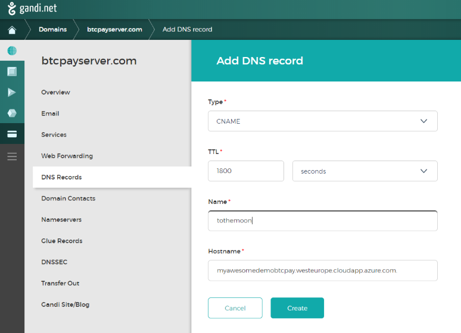
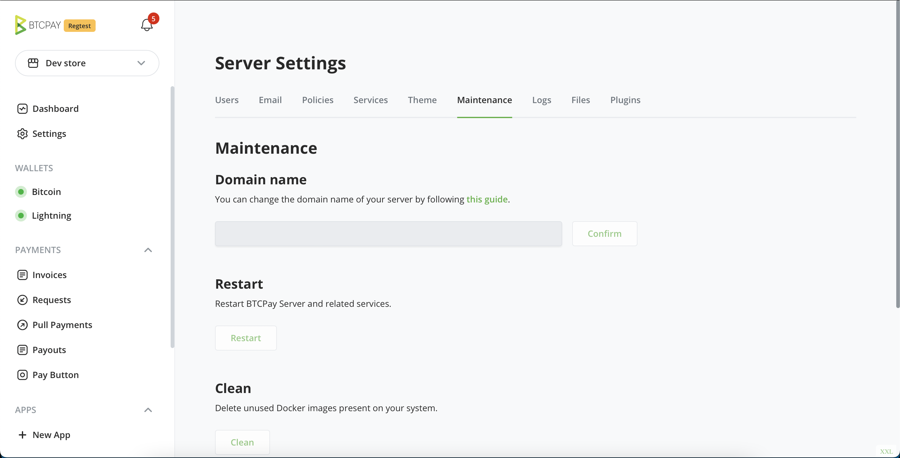
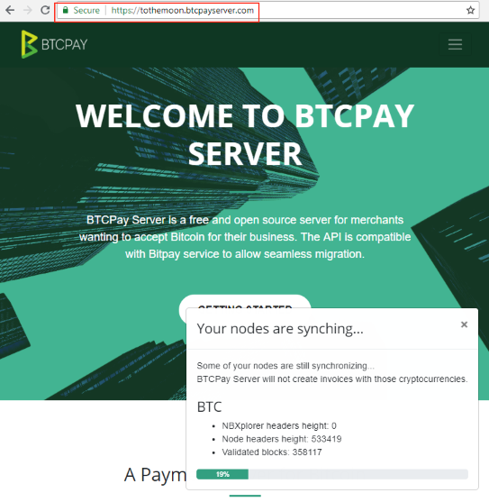

# Deployment FAQ

This document covers the most common questions, errors, and issues you may encounter prior and during the installation of the software. For a detailed list of deployment methods and instructions for each, please see [Deployment page](../Deployment/README.md).

[[toc]]

## General Deployment

### How much does it cost to run BTCPay Server?

BTCPay is a 100% free and open-source software. We do not charge you anything.
However, to run it, you should host it. You can run it as a self-hosted solution on your own local server, or use a cloud hosting provider, which is what a majority of users do. Advanced users can run BTCPay on [their own hardware](/Deployment/Hardware.md). Less technical users can use [Hardware As A Service options](/Deployment/HardwareAsAService.md). If you do not wish to host your own server, you can use a free [Third-Party Host](/Deployment/ThirdPartyHosting.md). Visit our [Deployment Page](/Deployment/README.md) for more information on the various ways in which you can run BTCPay.

### What are the minimal requirements for BTCPay?

If you would like to run Bitcoin and Lightning Network nodes, the minimal requirements are :

- 2GB Ram
- 80 GB of storage [with enabled pruning](../Docker/README.md#generated-docker-compose)
- Docker

### What is the easiest method to deploy a self-hosted BTCPay Server?

For beginners, we strongly recommend the [web-deployment](/Deployment/LunaNode.md) if you want a self-hosted solution or a [third-party host](/Deployment/ThirdPartyHosting.md).

If you're going to add more than one crypto coin, you need to expand the storage according to that coin(s) blockchain size.

### How to choose a proper deployment method?

Please see the [Deployment page](/Deployment/README.md) for comparison of different installation methods and choose the one that suits your needs and skill level the most.

### Can I run BTCPay on my own hardware?

Yes, you can. Check our the [Hardware Deployment page](/Deployment/Hardware.md) for detailed instructions.

### Can I deploy BTCPay on my existing VPS?

Yes. BTCPay is not limited to the documented deployment methods. You can use whichever hosting solution you prefer, that fits the minimal requirements.

### Are there free hosts where I can test?

On a self-hosted BTCPay, an unlimited amount of users and stores can be attached. Some community users have open registration on their servers for others to use their BTCPay Server mainly for testing and learning. Most of them are community-driven and free. See the [third-party hosts documentation](/Deployment/ThirdPartyHosting.md) for more information.

### After initial deployment, I can't register and I don't have a login yet?

When you deploy your BTCPay Server, you should first register a user (during server synchronization). This user is automatically the server admin. If your BTCPay only shows Login in the header menu, and you are unable to register the first user after initial deployment, someone else has registered on your server as the admin. Although this is unlikely to occur (the user would need to know and watch your BTCPay domain name), they had access to your ssh private keys, thus you should redeploy a new server for security reasons.

### How do I activate Tor on my BTCPay Server?

Tor is optional on Docker deployments. Run the following command as root to add
the Tor fragment and reapply setup:

```bash
btcpay-fragments add opt-add-tor
```

### How do I disable Tor on my BTCPay Server?

Run the following command as root:

```bash
btcpay-fragments remove opt-add-tor
```

Fragment changes immediately reapply setup. See the [optional fragments
guide](../Docker/fragments.md) for details.

### Why activate Tor? Does it mean that nobody knows who I am?

Tor for BTCPay server is intended more as an improvement of the setup process, and allows for more flexibility for hosting on one's own device at home or in an office.

Having Tor activated would allow for simpler, plug-and-play usage of BTCPay, as it suppress the need for the following configuration steps:

- Opening multiple ports on the firewall
- Configuring the NAT for port redirection to your device on your local network
- Setting up a DNS entry to get a HTTPS certificate
- Having a fixed IP for Lightning

While these steps are usually not a problem when BTCPay is hosted on a VPS, it can be difficult to solve for non-technical users on home or office networks.

Tor just solves all these issues in one shot, all you have to do is plug your device on the local network. It is especially useful for POS application.

But if you're looking for perfect privacy and security, **activating Tor with your BTCPay just won't do it.**

Tor is a really tricky software to use for developers, as the slightest mistake can tear down the anonymity it provides. As BTCPay is evolving into a rather complex service and adding more and more plugins, even if we tried to route all this traffic through Tor, we couldn't guarantee that there would never be leaks of data in clear.

We think that the illusion of security is more dangerous that no security, or at least security we know is imperfect. So be aware that activating Tor doesn't prevent others to connect to your instance website, your bitcoin or lightning node in clear, **it doesn't make you anonymous at all.**

If you want to know more about the philosophy behind all this, you can read our [article on Medium](https://medium.com/@BtcpayServer/about-tor-and-btcpay-server-2ec1e4bd5e51).

### How to access the .onion address without clearnet?

To see the .onion address of your BTCPay instance without accessing it through the clearnet and clicking the Tor logo in top left corner, apply the following command:

```bash
cat /var/lib/docker/volumes/generated_tor_servicesdir/_data/BTCPayServer/hostname
```

### How can I modify or deactivate environment variables?

Export the changed value and source setup again. For example:

```bash
export NBITCOIN_NETWORK="testnet"
. ./btcpay-setup.sh -i
```

Use `btcpay-fragments` instead of editing the additional and excluded fragment
variables directly. See the [Docker configuration
reference](../Docker/configuration.md) and [optional fragments
guide](../Docker/fragments.md).

### How can I run BTCPay on testnet?

Building on the section above, this is how you configure BTCPay to use `testnet` instead of the default `mainnet`:

```bash
# Export the NBITCOIN_NETWORK variable switching to testnet
export NBITCOIN_NETWORK="testnet"

# Run btcpay-setup.sh for the change to take effect
. btcpay-setup.sh -i
```

If you just want to test things quickly without deploying everything yourself, have a look at the [Try It Out](../TryItOut.md) section.
It provides links and explanations for a BTCPay testnet instance hosted by us.

### Can I start BTCPay only when I'm expecting a payment?

No, you need to keep your BTCPay running at all times so that your Bitcoin node stays in sync with the blockchain to verify transactions. If you only start it up every now and then, it would take a long time to catch up on verifying recent blocks, and your payments would not show up until much later.

### Can I connect to my BTCPay Bitcoin P2P on port 8333?

BTCPay's Bitcoin core node is not exposed externally by default. For BTCPay purposes, it is typically not in the interest of the user, as it increases the bandwidth requirement. BTCPay is also whitebinding connections to this port, so opening it would expose the node to potential DDoS.

When Tor is enabled, it exposes a P2P connection to your full node. You can get
the Tor address by running:

```bash
cat /var/lib/docker/volumes/generated_tor_servicesdir/_data/BTC-P2P/hostname
```

Or via the `Server Settings` of your BTCPay Server instance, logged as an administrator.

Please do not share this tor hidden service with untrusted parties. Connections to this hidden service are whitelisted by the bitcoin node, malicious peer would be able to DDoS your node.

If you need to unsafely expose bitcoind P2P port 8333 (for example if you require P2P for Bisq, DOJO, Esplora, etc.) and you are using a Docker deployment, you can use the [`opt-expose-unsafe`](/Docker/fragments/#lightning-and-node-features) additional fragment.

:::danger WARNING
ONLY USE ON TRUSTED LAN OR WITH FIREWALL RULES WHITELISTING SPECIFIC HOSTS
:::

### How can I renew my SSL certificate?

If your SSL certificate has expired for your BTCPay Server, you can manually renew it. For Docker deployments the easiest way to do this is to [restart the container](../Troubleshooting.md#13-restarting-a-service) named `letsencrypt-nginx-proxy-companion` on your server.

### Can I use an existing Nginx server as a reverse proxy with SSL termination?

Yes. Follow the Docker deployment guide for [terminating HTTPS with an external
reverse proxy](../Docker/networking.md#external-reverse-proxy).

## How to change your BTCPay Server domain name?

### Setting up DNS Records

You bought a domain and now want to connect that to your BTCPay Server.
The hosting party usually has a page to manage your domain.
Here you will find the `DNS records` page and add a `CNAME` record.

In this record you will make sure, it points to the provided domain by your VPS hoster.
You could also do this by IP address, but then instead of a `CNAME record` it would be an `A Record`.

This is an example of how this would look at [gandi.net](https://gandi.net/)



### Change domain name in BTCPay Server settings

In BTCPay Server you go to the `Server Settings` menu, and then into the tab `Maintenance`.
Here you will find a field to replace your old by the new set domain, it might take a few seconds to update.



Now enter the new set domain in the address bar and see if it works!



### Change domain on command line

Connect to your server through SSH.

Example :

```bash
ssh btcpayserver@myawesomedemobtcpay.westeurope.cloudapp.azure.com
```

Enter your password and change the domain name.

```bash
sudo su -
changedomain.sh tothemoon.btcpayserver.com
```

Success!

## Web-deployment

Here you can find common questions and solutions to BTCPay web-deployments.

### Can I run BTCPay on my home computer?

Similar to the requirements for hosting a website, a web server is required for a BTCPay Server instance. While it is possible to run BTCPay Server locally on your PC, it would have to meet the minimal requirements and also run 24/7 if you don't want interruptions of service. You might also not want to expose your home IP address for the activity related to BTCPay Server payments. For all these reasons, while local hosting is suitable for testing, it's not a viable solution for production. A Virtual Private Server (VPS) is commonly used to address these problems.

### LunaNode web-deployment

#### How to change domain name on my LunaNode BTCPay?

1. In your LunaNode dashboard, click on Virtual Machines > Your Virtual Machine > General Tab > External IP. Copy the external IP.
2. Go to your DNS provider and create an A record. Paste the external IP.
3. Go to Server Settings > Maintenance > Change Domain. Paste yourdomain.com without http or https prefix.

Additional documentation can be found here: [How to change your BTCPay Server domain name](../FAQ/Deployment.md#how-to-change-your-btcpay-server-domain-name)).

## Manual Deployment

#### How to manually install BTCPay on Ubuntu 18.04?

Check this [community guide](https://freedomnode.com/blog/114/how-to-setup-btc-and-lightning-payment-gateway-with-btcpayserver-on-linux-manual-install).

### How do I completely uninstall BTCPay from a Linux environment (Docker version)

Use the [`btcpay-teardown.sh`](https://github.com/btcpayserver/btcpayserver-docker/blob/master/btcpay-teardown.sh) script like this:

```bash
sudo su -
. ./btcpay-teardown.sh
```

This will completely erase BTCPay Server from your instance and remove the associated Docker containers and volumes.

### How to deploy BTCPay Server alongside existing Bitcoin node?

For Docker deployments, follow the authoritative guide for [using an existing
Bitcoin Core node](../Docker/customization.md#use-an-existing-bitcoin-core-node).

If you are looking for how to deploy alongside existing Lightning node [see this](./LightningNetwork.md#can-i-use-my-existing-ln-node-with-btcpay).

### With the docker deployment, how to use a different volume for the data?

First, you need to make sure that btcpayserver and docker is not running

```bash
sudo su -
btcpay-down.sh
systemctl stop docker
```

Now, you need to format your drive. If you have already done it, you can skip this step.

```bash
# Step 1: Unplug the drive
lsblk

# Step 2: Plug the drive
lsblk
```

The second `lsblk` should show the drive you just plugged in. (of TYPE `disk`)
Make sure you don't make a mistake as the next command will erase all data on this disk.

For the sake of the example, let's suppose it has the NAME `/dev/sdd`.

```bash
# Save the name in a variable
DEVICE_NAME="/dev/sdd"
# Set the partition name
PARTITION_NAME="/dev/sdd1"
```

Now we can partition the disk and format the partition:

```bash
echo "Partitioning the external drive $DEVICE_NAME..."
### DANGER ZONE ###
(
	echo o # Create a new empty DOS partition table
	echo n # Add a new partition
	echo p # Primary partition
	echo 1 # Partition number
	echo   # First sector (Accept default: 1)
	echo   # Last sector (Accept default: varies)
	echo w # Write changes
) | fdisk ${DEVICE_NAME}
partprobe ${DEVICE_NAME}
while ! lsblk $PARTITION_NAME &> /dev/null; do
	sleep 1
done
mkfs.ext4 -F "$PARTITION_NAME"
```

Then we need to mount the partition on the linux filesystem.

```bash
# Mounting the partition
MOUNT_DIR="/mnt/external"
mkdir "$MOUNT_DIR"
mount -o defaults,noatime "$PARTITION_NAME" "$MOUNT_DIR"

# Make sure the partition exists at the next reboot, we use UUID in case
# the partition name is different in the next reboot
if ! grep -qF "$MOUNT_DIR" /etc/fstab; then
	UUID="$(sudo blkid -s UUID -o value $PARTITION_NAME)"
	echo "UUID=$UUID $MOUNT_DIR ext4 defaults,noatime,nofail 0 2" >> /etc/fstab
fi
```

Then, we need to make sure that docker not start before the mount.

```bash
MOUNT_UNIT="$(systemd-escape --path "$MOUNT_DIR").mount"
docker_service="/lib/systemd/system/docker.service"
if ! grep -qF "After=$MOUNT_UNIT" "$docker_service"; then
	sed -i "s/After=/After=$MOUNT_UNIT /g" "$docker_service"
fi
```

Now, imagine you want to put all the docker volume data on the previous partition

```bash
DOCKER_VOLUMES="/var/lib/docker/volumes"
# Copy all the data from our volume to the mount directory (this can take a while)
cp -a -r "$DOCKER_VOLUMES/." "$MOUNT_DIR"
# Make the folder a mountpoint
rm -rf "$DOCKER_VOLUMES"
mkdir -p "$DOCKER_VOLUMES"
mount --bind "$MOUNT_DIR" "$DOCKER_VOLUMES"
# Make sure the mountpoint is mounted after reboot
if ! grep -qF "$DOCKER_VOLUMES" /etc/fstab; then
	echo "$MOUNT_DIR $DOCKER_VOLUMES none bind,nobootwait 0 2" >> /etc/fstab
fi
```

Now restart docker and btcpayserver

```bash
systemctl start docker
btcpay-up.sh
```

Note: We use mount bind instead of symbolic link because docker would complain when running `docker volume rm`.

### I get 503 Service Temporarily Unavailable nginx

#### Cause 1: Trying to access my BTCPay by IP address

When nginx receives a HTTP request, it needs to decide which service is the real destination. If you set `BTCPAY_HOST` to `http://raspberrypi.local/`, then you can only access BTCPay Server via this URL. Trying to access BTCPay with another domain name or with the IP address (for example `http://192.168.0.2`) will result in an HTTP 503 error.

```
503 Service Temporarily Unavailable
-----------------------------------
nginx
```

You can fix this by asking nginx to route such HTTP request to BTCPay Server instead.
Simply, re-run the setup script like this:

```bash
sudo su -

REVERSEPROXY_DEFAULT_HOST="$BTCPAY_HOST" && . btcpay-setup.sh -i
```

Now browsing to `http://192.168.0.2` should work properly.

#### Cause 2: btcpayserver or letsencrypt-nginx-proxy is not running

To check, run:

```bash
sudo  docker ps | less -S
```

Press "q" to quit out of less.

The output should contain:

- btcpayserver/letsencrypt-nginx-proxy-companion
- btcpayserver/btcpayserver

And the status should be "Up"

If the docker container is not running, then check the reason for crash like this:

```bash
 sudo  docker logs 6a6b9fd75692 --tail 20
```

Where 6a6b9fd75692 is the container ID that is having issues.

<a id="cause-3-btcpay-is-expecting-you-to-access-this-website-from"></a>

#### Cause 3: You access BTCPay Server over an unsecured network

This warning can appear when an external reverse proxy terminates HTTPS but
BTCPay Server does not receive or trust the original host and protocol headers.

After configuring the reverse proxy to forward these headers, reconfigure
BTCPay Server to trust them:

```bash
export TRUST_DOWNSTREAM_PROXY="true"
. btcpay-setup.sh -i
```

Only enable this when the BTCPay host's HTTP port is accessible exclusively
through the trusted reverse proxy. Follow the complete [external reverse proxy
configuration](/Docker/networking.md#external-reverse-proxy) for Nginx or
Apache, including the required security restrictions.

#### Cause 4: Getting 500 nginx error on a local server https and for http BTCPay is expecting you to access this website from

You need to open port 80 and 443. Once you did that, restart docker `btcpay-restart.sh`

#### Cause 5: Other

There could be many causes for 5XX HTTP errors. Please create an [Issue](https://github.com/btcpayserver/btcpayserver-docker/issues) and when cause becomes known add it here in the [Deployment FAQ](/FAQ/Deployment.md) doc.
