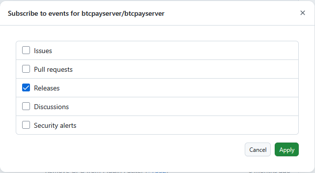

# Hardening BTCPay and General Security Best Practises

This guide will outline best practises to reduce your personal risk in case of an attack.

## When setting up your Instance

1. Choose a Hostname that is not btcpay, btc or crypto related (These terms will be searched for by hackers to identify potential targets)
2. In the Server Settings under Policies disable all unwanted features, also untick the option "Search engines can index this site". SEO optimization is not what you want here!
3. If you run BTCPay behind your own reverse proxy, consider using a SSL provider that is not Let's Encrypt (it's not currently possible to do so with the default setup)
4. Re-evaluate closely if you really need LND or CLN running on your node. These entail running a hot wallet on an internet reachable machine which must be considered high risk. For many merchants one of the Lightning plugins provided by the project will be enough. A read-only option would be Blink Plugin in non-custodial mode.
5. Be very mindful if you really need hot wallets on your server. In case of a security breach, the 12 seed words are an easy target and all an attacker needs to drains your entire funds.

## When Setting up your Store in BTCPay Server

Please evaluate if a hot wallet is really needed for your store. If you need it to process refunds, considering batching those pull-payments and signing them manually with a hardware wallet or keeping the absolute minimum amount for refunds in a hot wallet, i.e. refilling it on a weekly basis.

In general it is better to use a Hardware Wallet with [BTCPay Server Vault](../Vault/README.md) or even better a [MutliSig](../Multisig.md) setup with it.

No funds can be stolen from a saved xpub as long as the Seedphrase stays secure.

For your Lightning Wallet, consider as mentioned above one of the Lightning Plugins. Pay attention that there is a read-only option so that funds can not be taken out of your wallet, should the credential string be stolen.

## Updates and Communication

Make sure to keep your instance up-to-date. This is true for the operation system as well as BTCPay Server itself. Security is a moving target and must be attempted at all times.

It is recommended to Subscribe/Watch the [btcpayserver/btcpayserver repo](https://github.com/btcpayserver/btcpayserver) releases, by clicking "Watch" - "Custom" - "Releases". Also it is generally a good idea to follow the projects [X](https://x.com/BtcpayServer/) and/or [Nostr](https://njump.me/npub155m2k8ml8sqn8w4dhh689vdv0t2twa8dgvkpnzfggxf4wfughjsq2cdcvg) accounts for critical information.

