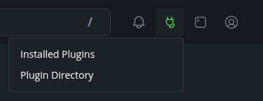

# Plugins

Plugins add features to a BTCPay Server instance. They can provide new payment options, integrations, or tools for a store. Some features are included with BTCPay Server, while others are installed by the person who runs the server.

## Find and use plugins

Server administrators can open the **Plugins** icon in the top-right menu and select **Plugin Directory** to search or browse available plugins. Select **Installed Plugins** in the same menu to see plugins already installed on the server.

Installed plugins may add store-specific features to the sidebar. What you see depends on the plugins installed on the server and the store you have selected. If you are not a server administrator, ask your administrator to install a missing plugin and check the plugin's documentation for any store setup it requires.

You can browse the [public plugin directory](https://plugin-builder.btcpayserver.org/public/plugins/) without installing anything. Open a plugin's page to read its description, author, supported BTCPay Server versions, source code link, and user reviews. A plugin listed in the directory is not necessarily installed on your server.

## Install a plugin

Only a server administrator can install plugins:

1. Open the **Plugins** icon in the top-right menu and select **Plugin Directory**.
2. Search or browse for the plugin, then open its details. Check the author, documentation, source code, and supported BTCPay Server version before installing it.
3. Select the version you want to install, click **Install**, and confirm the installation in the dialog.
4. The plugin is scheduled for installation. Click **Restart now** in the notice at the top of the page to restart BTCPay Server and apply the change. The server is temporarily unavailable during the restart.
5. After the server restarts, open **Plugins** > **Installed Plugins** to check that the plugin is installed. Follow the plugin's own documentation to configure any server or store settings it needs.

## Remove a plugin

Only a server administrator can remove plugins. Check whether any stores rely on the plugin before removing it:

1. Open the **Plugins** icon in the top-right menu and select **Installed Plugins**.
2. Find the plugin and click **Uninstall**. This schedules the plugin for removal; the removal takes effect after the server restarts.
3. Click **Restart now** in the notice at the top of the page to apply the removal. The server is temporarily unavailable during the restart.
4. After the server restarts, return to **Plugins** > **Installed Plugins** to check that the plugin is no longer listed.

:::warning
Install plugins only from sources you trust. Plugins run inside the BTCPay Server process and can access server services and data. A listing in the public directory is not a security audit or endorsement by BTCPay Server. Review the plugin's source, maintainer, and compatibility before installing it, and keep a backup of your server.
:::

## Review a plugin

If you have used a plugin, you can help others evaluate it. Open the plugin's page in the [public plugin directory](https://plugin-builder.btcpayserver.org/public/plugins/), sign in to Plugin Builder, and select **Write a review**. Give a rating and describe your experience, including the version you used and any problems you encountered. Ratings and detailed reviews build a shared record of users' experiences and help others decide which plugins to trust. They do not replace checking a plugin's security or suitability for your server.

If you want to create a plugin, see the [plugin development guide](/Developers/plugins/).
